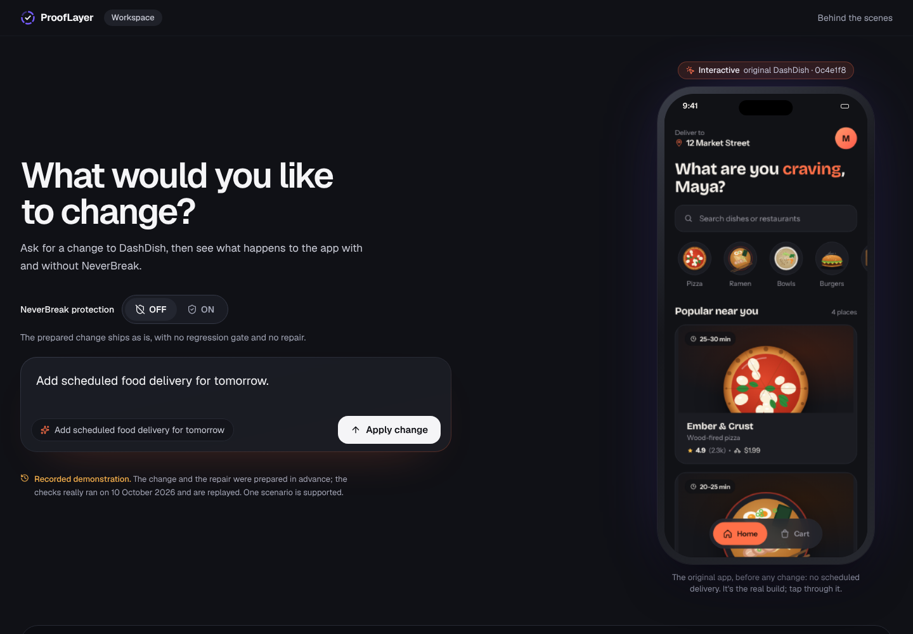
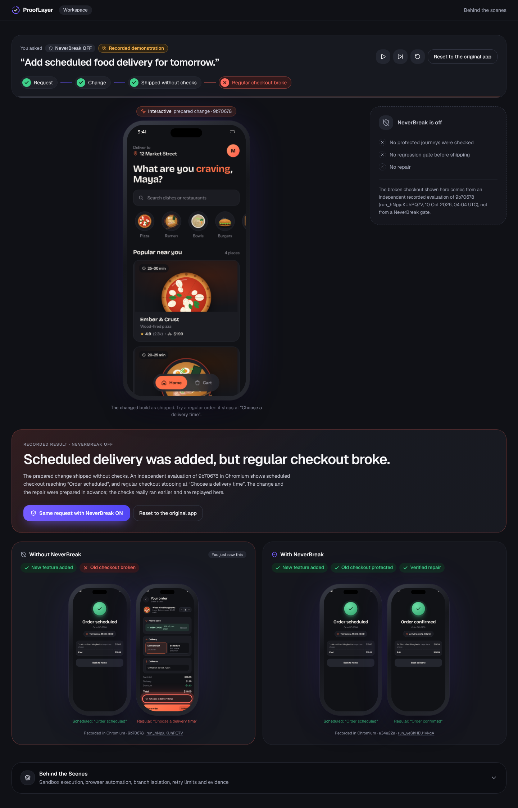
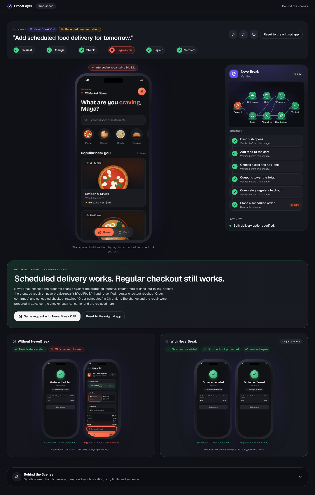
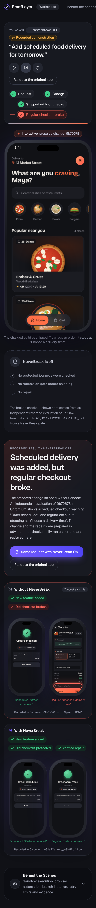
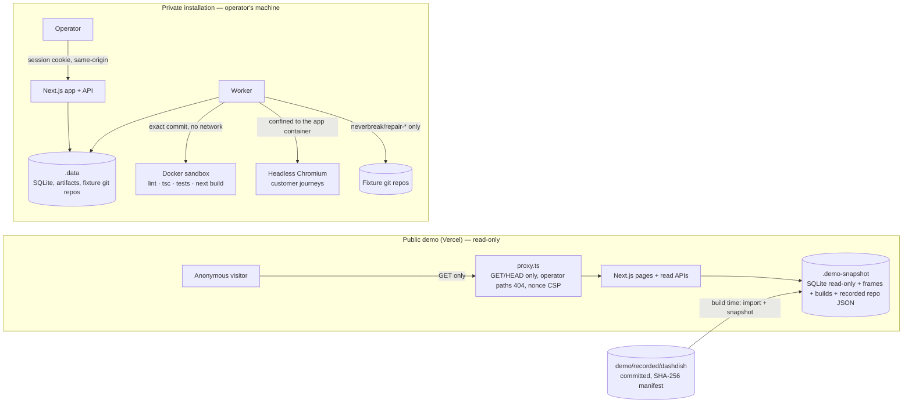

# ProofLayer

**Independent verification of AI-generated code changes, with a regression gate that protects what already works.**

**Live demo:** <https://prooflayer-steel.vercel.app/> (a read-only replay of recorded runs; see [Recorded vs live](#recorded-vs-live-prepared-vs-generated)).

ProofLayer takes a code change, as an AI coding agent would produce it, and runs it through checks it cannot influence:
- install, lint, type checking, tests and a production build in a network-less Docker sandbox
- real customer journeys in headless Chromium

The result is a verdict decided from exit codes, with the evidence to back it.

Its regression gate, **NeverBreak**, remembers which journeys passed before a change. It checks those journeys again after the change. When one breaks, it tries a controlled repair on an isolated branch, and verifies that repair the same way.

This is an independent portfolio prototype. It is not affiliated with any company and has no access to anyone's systems or data. It verifies two fictional demo repositories, and the public deployment is a **read-only recorded demonstration**.

| The original app, the toggle and the prompt | NeverBreak OFF | NeverBreak ON |
|---|---|---|
|  |  |  |
| **Without vs with NeverBreak** | **Phone** | |
|  |  | |

## Contents

1. [The problem](#the-problem)
2. [NeverBreak](#neverbreak)
3. [The controlled DashDish example](#the-controlled-dashdish-example)
4. [Features](#features)
5. [Architecture](#architecture)
6. [Technology](#technology)
7. [Request and verification lifecycle](#request-and-verification-lifecycle)
8. [Run it locally](#run-it-locally)
9. [Configuration](#configuration)
10. [Security](#security)
11. [Recorded vs live, prepared vs generated](#recorded-vs-live-prepared-vs-generated)
12. [Tests and validation](#tests-and-validation)
13. [Deployment](#deployment)
14. [Limitations](#limitations)
15. [Future work](#future-work)
16. [How this was built](#how-this-was-built)
17. [Licence](#licence)
18. [Documentation](#documentation)

## The problem

AI coding agents make plausible changes quickly. The changes that hurt are rarely the ones that fail to compile; they are the ones that pass, ship a new feature, and quietly break something that used to work.

Asking the agent "don't break checkout" every time doesn't scale. And the agent's own claim that the tests pass is not independent evidence.

## NeverBreak

1. **Learn.** From the last passing run, every passing test and every Chromium journey that reached its expected screen becomes a protected flow, stored with the commit it came from.
2. **Check.** Every new change runs the full pipeline. A protected flow passes only if its own test passed and, where it has one, its journey reached the expected screen in this run.
3. **Detect.** A failed or deleted protected test is a regression. If the change edited the test that protects a flow, the flow is flagged even when the test passes.
4. **Repair, carefully.** At most two attempts, each a real commit on an isolated `neverbreak/repair-*` branch and each verified like any other change:
   - The first attempt applies a prepared targeted fix when one exists. Otherwise it restores the code the change touched.
   - The second attempt rolls back the change.

   A repair counts as **repaired** only if the change's new feature still passes; otherwise it is reported as a **roll-back**. Nothing is merged, pushed or deployed.

## The controlled DashDish example

DashDish is a fictional food-delivery app kept as a real git repository (`scripts/create-dashdish.sh`, deterministic SHAs). One request is supported: *"Add scheduled food delivery for tomorrow."*

| Revision | Commit | What it is | Recorded result |
|---|---|---|---|
| Original | `0c4e1f8` | Menu, customisation, cart, coupons, checkout. No scheduled delivery | Passed. Regular checkout reaches "Order confirmed" in Chromium |
| Prepared change | `9b70678` | Adds scheduled delivery, but requires a delivery window for *every* order | **Failed.** Test: expected `Order confirmed`, received `Choose a delivery time`. Scheduled checkout reaches "Order scheduled" |
| Prepared repair | `2341e46` on `prepared-fixes/scheduled-delivery` | Only scheduled orders need a window | Applied on an isolated branch as `e34e22a`: **Passed** 5 protected flows and the change's 3 new checks |

The demo has one prompt and one toggle:
- **NeverBreak OFF:** the change ships with no gate. Scheduled delivery works and regular checkout breaks: *"Scheduled delivery was added, but regular checkout broke."*
- **NeverBreak ON:** the same change is checked, the regression is caught, and the prepared repair is applied and verified: *"Scheduled delivery works. Regular checkout still works."*

Each final line appears only when the recorded Chromium evidence shows it. Any other request is declined with "This prototype currently supports the scheduled-delivery demonstration."

## Features

- **Prompt-first demo.** Deterministic request matching (`lib/shared/intent.ts`), with no language model. The NeverBreak OFF/ON toggle changes server behaviour: a request made with protection off is recorded as such, and the repair API refuses it.
- **Interactive phone preview** of the exact static build each run verified: the original, the changed revision and the repaired revision.
- **Recorded browser evidence:** two customer journeys per run, a PNG frame per step, expected vs actual.
- **Sandboxed verification worker:** install, lint, `tsc`, tests and `next build` in Docker, then journeys in Chromium.
- **Structured proof** parsed from recorded output: test assertions, TypeScript and ESLint errors, and source excerpts from the commit.
- **Controlled repair** on isolated branches, at most two attempts, each verified.
- **Technical detail stays out of the demo.** Exact revisions, commands, exit codes, frames, repair branches and boundaries are documented here and in [docs/](docs/). The detailed pages (Run detail, Runs, Protected Flows, Compare) still exist at their URLs, but the demo doesn't link to them.
- **Optional AI explanations** of failed checks (private mode). They are stored separately and can never change a verdict.

## Architecture



- **The web app never executes checked code.** It reads the database. Only the worker runs code: inside Docker, or as a confined browser.
- **One source of truth.** The interface shows only rows the worker wrote. Verdicts come from one function (`lib/shared/verdict.ts`), from exit codes; browser frames and AI text never feed into a verdict.
- **The public deployment contains no worker, Docker, git, secrets or sign-in.** It reads an immutable snapshot built at deploy time from the committed recorded package.

More: [docs/ARCHITECTURE.md](docs/ARCHITECTURE.md).

## Technology

| | |
|---|---|
| **App** | Next.js 16 (App Router, Turbopack), React 19, TypeScript 5.9, Tailwind CSS 4, Motion, lucide-react, Geist |
| **Data** | SQLite via Node's built-in `node:sqlite` (Node ≥ 22.18). Read-only snapshot in the public demo |
| **Worker** | Node, Docker (`prooflayer-runner:node22`, non-root, no npm), headless Chromium via `playwright-core` |
| **Tests** | `node --test` (TypeScript run directly by Node), ESLint, `tsc` |
| **Hosting** | Vercel for the public read-only demo. The worker runs on a private machine only |

## Request and verification lifecycle

**Recorded mode** (public demo, or any installation without a worker):
1. The prompt is matched in the browser.
2. The recorded runs for that scenario are replayed from stored timestamps, labelled "Recorded demonstration".
3. The page makes no server writes.

**Live mode** (private, operator signed in, worker and Docker running):

1. `POST /api/projects/dashdish/requests` with `{ prompt, protection }`. The server checks the operator session, same-origin, the body schema, the same deterministic matcher, and the worker heartbeat. It then queues the prepared revision for that scenario.
2. The worker claims the run. It exports the exact commit, runs `npm ci` on the host under a fixed policy (registry-only lockfile, pinned npm config, no scripts, no git), and then runs each check in Docker with no network.
3. After a passing build, it serves the static export on an internal Docker network and runs the customer journeys in Chromium, confined to that container.
4. Every state change is written to SQLite. The page polls and shows only what was recorded.
5. **Protection ON:** if a protected flow failed, the page requests the controlled repair. The worker verifies each attempt as a normal run on `neverbreak/repair-*`.
6. **Protection OFF:** no repair, and the API refuses one (409).

## Run it locally

You need Node.js ≥ 22.18 and git.

### Recorded demo (no Docker)

```bash
npm ci
npm run demo:init            # builds the fixture repositories with git, imports the recorded runs (hash-verified)
npm run build && npm start   # http://localhost:3000
```

### The public read-only build (what Vercel serves)

```bash
npm ci
npm run build:public         # demo:init + immutable snapshot + PROOFLAYER_PUBLIC_DEMO=true next build
npm run start:public         # http://localhost:3000
node scripts/security-smoke.mjs http://localhost:3000
```

### Private live worker

You also need Docker, and Chromium for the journeys (`npx playwright install chromium`).

```bash
cp .env.example .env.local   # set PROOFLAYER_ACCESS_CODE (≥ 12 chars) and PROOFLAYER_SESSION_SECRET (openssl rand -hex 32)
npm ci
npm run setup                # fixture repositories, projects, sandbox image
npm run build && npm start
npm run worker               # second terminal
```

Sign in at `/operator`. Use the production server; the Next.js dev server blocks the preview's assets.

## Configuration

Every variable is server-only. The public demo needs **none**; see [docs/DEPLOYMENT.md](docs/DEPLOYMENT.md).

| Variable | Mode | Purpose |
|---|---|---|
| `PROOFLAYER_PUBLIC_DEMO` | both | `true` means the public read-only demo, `false` means private. When unset: public on Vercel, private elsewhere. Unknown values mean public |
| `PROOFLAYER_ACCESS_CODE` | private | Operator sign-in code, ≥ 12 characters. Without it, nobody can sign in |
| `PROOFLAYER_SESSION_SECRET` | private | HMAC key for session cookies, ≥ 32 characters |
| `ANTHROPIC_API_KEY`, `PROOFLAYER_ANTHROPIC_MODEL` | private, optional | AI explanations of failed checks |
| `PROOFLAYER_GITHUB_REPOSITORY`, `PROOFLAYER_GITHUB_TOKEN` | private, optional | One allowlisted repository; the token should be read-only |
| `PROOFLAYER_CHROMIUM_PATH` | private, optional | Chromium for journeys; auto-detected from Playwright's cache |
| `PROOFLAYER_DATA_DIR`, `PROOFLAYER_RUNNER_*`, `*_TIMEOUT_MS` | private, optional | Data location, sandbox image and limits (see `.env.example`) |

## Security

The full threat model, findings, fixes, tests and residual risks are in [docs/SECURITY_AUDIT.md](docs/SECURITY_AUDIT.md). In short:

- **Public demo, enforced on the server, three times over:**
  - `proxy.ts` allows only GET and HEAD, and hides operator paths.
  - Every privileged route handler refuses on its own, through `apiUser`, before reading anything.
  - The data is opened read-only, so any write fails.

  No sign-in exists there, and operator secrets in the environment are ignored. Raw execution logs, AI text and server configuration are withheld from visitors.
- **Authentication (private):**
  - one operator, unlocked by an access code compared in constant time
  - HMAC-signed, `__Host-` prefixed, httpOnly, Secure, SameSite=Lax session cookies with a 12-hour expiry
  - signing out revokes every earlier session
  - Origin and Fetch Metadata CSRF checks
  - per-client and global sign-in limits
- **Worker:**
  - Docker with `--network none`, a read-only root, uid 10001, `cap-drop ALL`, `no-new-privileges`, and CPU, memory, PID and time limits
  - commands come only from a server allowlist
  - git calls use argument arrays and validated refs, and may write only `neverbreak/repair-*`
  - the host-side `npm ci` can't be steered by the repository
  - Chromium can reach only the app under test
- **Headers:** a per-request nonce CSP, `frame-ancestors 'none'`, HSTS, nosniff, COOP and a strict referrer policy. Previews of untrusted builds are always sandboxed.

## Recorded vs live, prepared vs generated

| | What it is | How it is labelled |
|---|---|---|
| **Recorded demonstration** | Genuine runs recorded on 10 October 2026 by ProofLayer's worker (Docker sandbox, headless Chromium), committed with a SHA-256 manifest and replayed | "Recorded demonstration" everywhere. Playback is never presented as execution |
| **Live verification** | Checks running now on the operator's worker | "Live verification", available only with a running worker and Docker |
| **Prepared change** (`9b70678`) | Written in advance to stand in for an AI agent's work | "written in advance for this demo, not generated" |
| **Prepared repair** (`2341e46`) | A targeted fix written in advance and kept on a `prepared-fixes/` branch | "written in advance, not generated". There is **no AI-generated repair** in this project |

The verification checks, browser journeys and evidence are genuine. The change and the repair are not generated, and the prototype supports one controlled scenario, not arbitrary coding requests.

## Tests and validation

```bash
npm test                     # 141 tests: verdicts, proofs, flows, repair planning, persistence,
                             # authorisation, public-demo enforcement (every route handler), sessions,
                             # CSRF, sign-in limits, install policy, recorded package integrity
npm run typecheck
npm run lint
npm audit --omit=dev
node scripts/security-smoke.mjs <url>   # 42 HTTP checks against a running public demo
```

GitHub Actions (`.github/workflows/ci.yml`) runs all of these, builds the public demo, and runs the smoke test against it.

Last verified on 24 November 2026 with Node 22 and Next.js 16.4.6: 141 of 141 tests pass, `tsc` and ESLint are clean, both production builds succeed, the smoke test passes 42 of 42 against the local public build, `npm audit --omit=dev` reports 0 vulnerabilities, and gitleaks reports no leaks across the git history. The Docker worker and the Chromium journeys were not re-run for this check; their last recorded runs are in [docs/VALIDATION.md](docs/VALIDATION.md).

Validation reports: [docs/VALIDATION.md](docs/VALIDATION.md) (what was executed, with run IDs) and [docs/SECURITY_AUDIT.md](docs/SECURITY_AUDIT.md).

## Deployment

- **Public:** Vercel. `vercel.json` runs `npm run build:public`, which recreates the fixture repositories, imports the committed recorded package and builds the immutable snapshot. Commands and environment are in [docs/DEPLOYMENT.md](docs/DEPLOYMENT.md).
- **Private:** one machine with Docker runs `npm start` and `npm run worker` against the same `.data`. It is not exposed publicly.

## Limitations

- **Scope:** one controlled scenario (DashDish scheduled delivery). Requests are matched by rules; nothing is generated.
- **What can be verified:**
  - Only Node projects with a `package-lock.json` from the npm registry.
  - Supported test runners are `node --test`, `vitest` and `jest`, with `next build`.
  - Install scripts are disabled.
- **What "Passed" means:** the configured checks succeeded on that commit, and only the selected protected journeys were exercised in a browser. It is not proof that the application has no bugs.
- **Live verification:** runs on a single machine, one run at a time, for one operator. No multi-tenant isolation.
- **AI explanations:** only their failure paths were tested; no API key was available.

More: [docs/LIMITATIONS.md](docs/LIMITATIONS.md).

## Future work

- **Agent integration:** a real agent producing the change, with ProofLayer as an independent gate (for example, a GitHub check on the agent's pull request).
- **Hosted worker:** an isolated, hosted worker (a gVisor- or Firecracker-class runtime) reporting through an authenticated API, with Postgres and row-level security (see `db/supabase/`, currently unused).
- **AI-proposed repairs:** verified exactly like prepared ones, and labelled as generated.
- **Scope:** more ecosystems and test runners, and user-defined journeys with review.

## How this was built

I built ProofLayer with AI coding assistants. I set the scope, the threat model and the rules for what counts as evidence, reviewed the code, and ran the checks reported here. The recorded runs were produced by this code on a real worker. Nothing in the demo is presented as generated by a model: the change and the repair were written in advance and are labelled that way.

## Licence

Copyright © 2026 Rashmi B. All rights reserved. The source is public so it can be read and evaluated; it is not licensed for reuse. See [LICENSE](LICENSE).

## Documentation

| File | Contents |
|---|---|
| [docs/SECURITY_AUDIT.md](docs/SECURITY_AUDIT.md) | Threat model, findings, fixes, tests, residual risks, release decision |
| [docs/DEPLOYMENT.md](docs/DEPLOYMENT.md) | Vercel commands, public environment, post-deploy checks, private installation |
| [docs/VALIDATION.md](docs/VALIDATION.md) | Exactly what was executed, with run IDs, and what was not |
| [docs/ARCHITECTURE.md](docs/ARCHITECTURE.md) | How NeverBreak learns, checks and repairs; the sandbox |
| [docs/FEATURES.md](docs/FEATURES.md) | Feature provenance with evidence |
| [docs/LIMITATIONS.md](docs/LIMITATIONS.md) | What a verdict means, what isn't built |
| [docs/CASE_STUDY.md](docs/CASE_STUDY.md) | Design rationale across versions |
| [docs/WALKTHROUGHS.md](docs/WALKTHROUGHS.md) | 60–90 s walkthrough scripts |

### Project layout

```
app/                  pages and API routes (App Router); proxy.ts at the root
components/showcase/  the prompt-first demo (studio, home, run, comparison, phone, inspector)
lib/shared/           pure logic: verdict, proof parsing, intent, flows, redaction, types
lib/server/           config, database, store, auth/session, viewer, providers, repair, preview
worker/               verification worker, executor, install policy, browser journeys
scripts/              setup, fixtures, recorded package import/export, public snapshot, security smoke test
demo/recorded/        the committed recorded package (SHA-256 manifest)
fixtures/             DashDish and Ledgerly source revisions
tests/                node --test suites
db/                   SQLite schema; supabase/ (unused reference migration)
```
