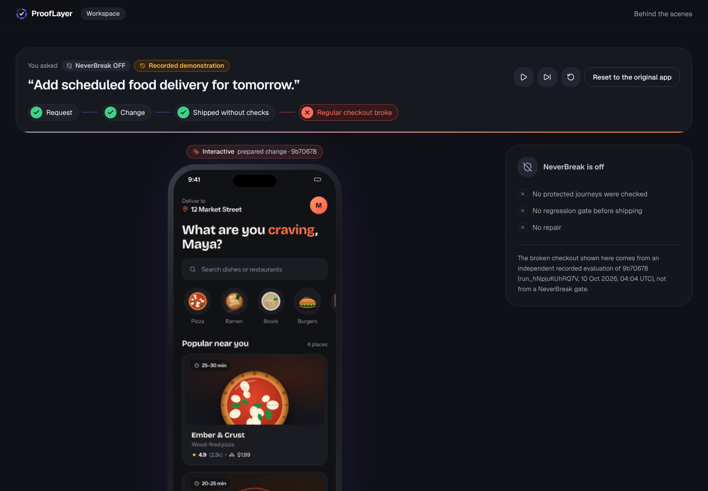
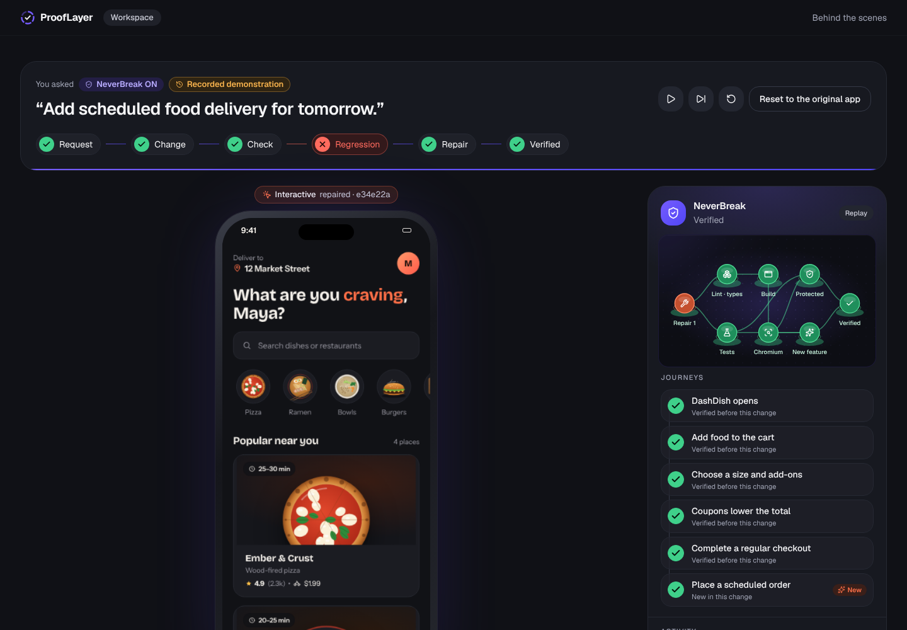
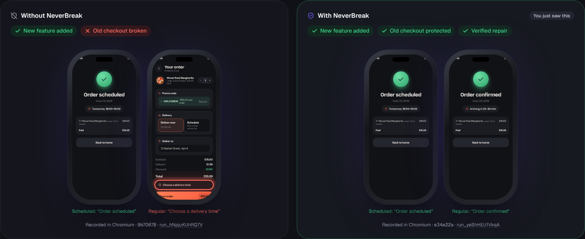
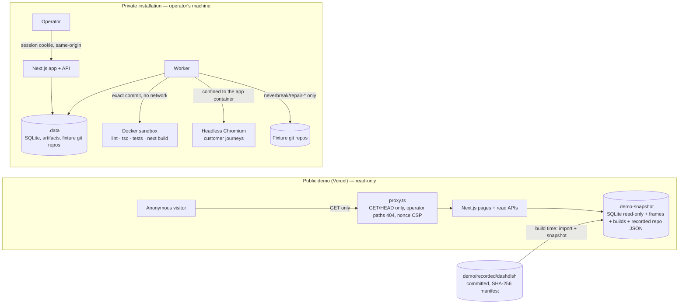

# ProofLayer

**Independent verification of AI-written code changes, with a regression gate that protects what already works.**

**Live demo:** <https://prooflayer-steel.vercel.app/> · read-only replay of recorded runs

ProofLayer takes a code change, as an AI coding agent would produce it, and runs it through checks the agent cannot influence: install, lint, types, tests and a production build in a network-less Docker sandbox, then customer journeys in headless Chromium. The verdict is decided from exit codes, with the evidence kept beside it. Its regression gate, **NeverBreak**, re-checks the journeys that passed before the change and, when one breaks, verifies a controlled repair the same way.

This is an independent prototype, not a product. It is not affiliated with any company, verifies two fictional demo apps, and has no users.

<table>
  <tr>
    <td width="33%" valign="top"></td>
    <td width="33%" valign="top"></td>
    <td width="33%" valign="top"></td>
  </tr>
</table>

**1. Request:** one prompt, one toggle, the original app. **2. NeverBreak off:** the change ships and regular checkout breaks. **3. NeverBreak on:** the regression is caught, repaired and verified. Below, the recorded phone captures side by side.

<p align="center"></p>

## What is real

- **Recorded verification.** Genuine runs made on 10 October 2026 by ProofLayer's worker (Docker sandbox, headless Chromium), committed with a SHA-256 manifest and replayed in the public demo. Labelled "Recorded demonstration"; playback is never presented as execution.
- **Live execution.** The same checks running now on a private machine with the worker and Docker. Labelled "Live verification". Not hosted; tested on one machine.
- **Prepared change** (`9b70678`). Written in advance to stand in for an AI agent's work, and labelled "written in advance for this demo, not generated".
- **Prepared repair** (`2341e46`). A targeted fix written in advance and kept on a `prepared-fixes/` branch, labelled "written in advance, not generated". There is **no AI-generated repair** in this project.

The checks, browser journeys and evidence are genuine. The change and the repair are not generated, and the prototype supports one controlled scenario, not arbitrary coding requests.

## How it works

1. **Learn.** From the last passing run, every passing test and every Chromium journey that reached its expected screen becomes a protected flow.
2. **Check.** Each change runs the full pipeline. A flow passes only if its own test passed and, where it has one, its journey reached the expected screen in this run.
3. **Detect.** A failed or deleted protected test is a regression. If the change edited the test that protects a flow, the flow is flagged even when the test passes.
4. **Repair, carefully.** At most two attempts, each a real commit on an isolated `neverbreak/repair-*` branch, each verified like any other change. A result counts as **repaired** only if the new feature still passes; otherwise it is reported as a **roll-back**. Nothing is merged, pushed or deployed.

### The controlled example

DashDish is a fictional food-delivery app kept as a real git repository with deterministic commits. One request is supported: *"Add scheduled food delivery for tomorrow."*

| Revision | Commit | Recorded result |
|---|---|---|
| Original | `0c4e1f8` | **Passed.** Regular checkout reaches "Order confirmed" in Chromium |
| Prepared change | `9b70678` | **Failed.** Expected `Order confirmed`, received `Choose a delivery time` |
| Prepared repair | `2341e46`, applied as `e34e22a` | **Passed.** 5 protected flows and the change's 3 new checks |

## Architecture



- **The web app never executes checked code.** It reads the database. Only the worker runs code: inside Docker, or as a confined browser.
- **One source of truth.** Verdicts come from one function (`lib/shared/verdict.ts`), from exit codes. Infrastructure errors, timeouts and skipped checks become *incomplete*, never *failed* or *passed*. Browser frames and AI text never feed into a verdict.
- **The public deployment has no worker, Docker, git, secrets or sign-in.** It reads an immutable snapshot built from the committed recorded package.

More: [docs/ARCHITECTURE.md](docs/ARCHITECTURE.md), including the request and verification lifecycle.

## Capabilities

- **Sandboxed checks:** `npm ci` under a fixed policy, then lint, `tsc`, tests and `next build`, each in its own container.
- **Browser evidence:** scripted customer journeys in Chromium, a hashed PNG frame per step, expected versus actual.
- **Structured proof** parsed from recorded output: test assertions, TypeScript and ESLint errors, and source excerpts from the commit.
- **Regression gate and controlled repair** on isolated branches, as described above.
- **Interactive preview** of the exact static build each run verified.
- **Optional AI explanations** of failed checks (private mode only). Stored separately; they cannot change a verdict.

Provenance of every feature, marked LIVE, LOCAL ONLY, EXAMPLE or PLANNED: [docs/FEATURES.md](docs/FEATURES.md).

## Security controls

- **Sandbox:** Docker with `--network none`, a read-only root, uid 10001, `cap-drop ALL`, `no-new-privileges`, and CPU, memory, PID and time limits.
- **No repository-controlled commands:** commands come from a server allowlist; the host-side `npm ci` accepts only a registry lockfile with integrity hashes, with scripts, git and the repository's `.npmrc` disabled.
- **Confined browser:** Chromium can reach only the app under test, on an internal Docker network.
- **Public demo, enforced three times:** `proxy.ts` allows only GET and HEAD, every privileged route refuses on its own, and the data is opened read-only.
- **Private mode:** one operator behind an access code, HMAC-signed `__Host-` session cookies, CSRF checks and sign-in limits.

Threat model, findings, fixes and residual risks: [docs/SECURITY_AUDIT.md](docs/SECURITY_AUDIT.md).

## Verification

| Check | Result | Date |
|---|---|---|
| `npm test` | 141 of 141 pass | 24 Nov 2026 |
| `tsc --noEmit`, `eslint .` | Clean | 24 Nov 2026 |
| `npm run build`, `npm run build:public` | Both succeed | 24 Nov 2026 |
| `npm audit` and `npm audit --omit=dev` | 0 vulnerabilities (Next.js 16.4.6) | 24 Nov 2026 |
| gitleaks over the git history | No leaks | 24 Nov 2026 |
| `scripts/security-smoke.mjs` against the production Vercel deployment | 42 of 42, run by me | 24 Nov 2026 |
| Docker worker and Chromium journeys | Last run during the October audit; not repeated since | Oct 2026 |

GitHub Actions (`.github/workflows/ci.yml`) runs the tests, type check, lint, audit, the public build and the smoke test against it. What was executed, with run IDs, and what was not: [docs/VALIDATION.md](docs/VALIDATION.md).

## Run it locally

Needs Node.js ≥ 22.18 and git. Stack: Next.js 16, React 19, TypeScript, SQLite through `node:sqlite`, Docker, and Chromium through `playwright-core`.

```bash
# Recorded demo, no Docker
npm ci
npm run demo:init            # builds the fixture repositories, imports the recorded runs (hash-verified)
npm run build && npm start   # http://localhost:3000
```

```bash
# Private live worker: also needs Docker and Chromium (npx playwright install chromium)
cp .env.example .env.local   # set PROOFLAYER_ACCESS_CODE and PROOFLAYER_SESSION_SECRET
npm ci
npm run setup                # fixture repositories, projects, sandbox image
npm run build && npm start
npm run worker               # second terminal; sign in at /operator
```

Every variable is server-only and documented in [.env.example](.env.example); the public demo needs none. Deployment: [docs/DEPLOYMENT.md](docs/DEPLOYMENT.md).

## Limitations

- **Scope:** one controlled scenario. Requests are matched by rules; nothing is generated.
- **What can be verified:** Node projects with an npm-registry `package-lock.json`; `node --test`, `vitest` or `jest`; `next build`. Install scripts are disabled.
- **What "Passed" means:** the configured checks succeeded on that commit and the selected journeys reached their expected screens. It is not proof that the application has no bugs.
- **Live verification:** one machine, one run at a time, one operator. No multi-tenant isolation, not hosted.
- **Repair:** restores or rolls back code known to have passed, or applies the one prepared fix. It does not write fixes.
- **AI explanations:** only their failure paths were tested; no real model response has been generated.
- **No users:** there has been no usability testing.

More: [docs/LIMITATIONS.md](docs/LIMITATIONS.md).

## How this was built

I designed ProofLayer around a simple principle: AI-generated code changes should be independently verified, and verdicts should come from recorded execution evidence rather than an agent's claims.

Built with AI coding agents under my direction, the prototype explores sandboxed verification, regression protection and controlled repair. The agents implemented the code and ran the automated tests and the security audit. I ran the final hosted security verification myself, passing all 42 checks.

The public demo replays genuine Docker and Chromium execution evidence using a prepared change and repair.

## Documentation

| File | Contents |
|---|---|
| [docs/ARCHITECTURE.md](docs/ARCHITECTURE.md) | How NeverBreak learns, checks and repairs; the sandbox; the request lifecycle |
| [docs/SECURITY_AUDIT.md](docs/SECURITY_AUDIT.md) | Threat model, findings, fixes, tests, residual risks |
| [docs/VALIDATION.md](docs/VALIDATION.md) | Exactly what was executed, with run IDs, and what was not |
| [docs/FEATURES.md](docs/FEATURES.md) | Feature provenance with evidence |
| [docs/LIMITATIONS.md](docs/LIMITATIONS.md) | What a verdict means, what isn't built |
| [docs/DEPLOYMENT.md](docs/DEPLOYMENT.md) | Vercel commands, public environment, private installation |

```
app/         pages and API routes (App Router); proxy.ts at the root
lib/shared/  pure logic: verdict, proof parsing, flows, redaction
lib/server/  config, database, auth, repository providers, repair
worker/      verification worker, executor, install policy, browser journeys
fixtures/    DashDish and Ledgerly source revisions
demo/        the committed recorded package (SHA-256 manifest)
tests/       node --test suites
```

## Licence

Copyright © 2026 Rashmi B. All rights reserved. The source is public so it can be read and evaluated; it is not licensed for reuse. See [LICENSE](LICENSE).
