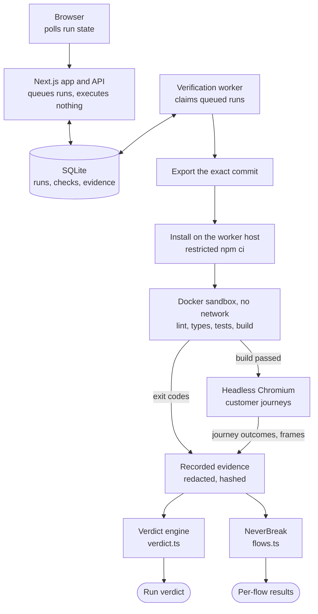
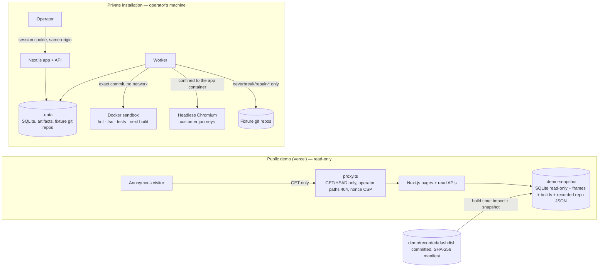

# Architecture

How a change is verified: the components, the execution pipeline, what each kind of evidence decides, how NeverBreak learns and repairs, and how the public demo differs from a private installation.

## NeverBreak, step by step

1. **Learn.** From the last passing run, every test the runner reported as passing becomes a protected flow, plus the built page opening in Chromium and any customer journey that reached its expected screen. Stored with the commit it was learned from.
2. **Check.** Each new change runs the full pipeline below. A flow passes only if its own test passed in this run's recorded output and, where it has one, its Chromium journey reached the expected screen.
3. **Notice.** Failed or deleted tests are regressions. If the change rewrote the test protecting a flow, the flow is flagged even when it passes.
4. **Repair.** At most two attempts, each a real commit on a `neverbreak/repair-*` branch verified by a normal run, re-checking protected flows and the change's new checks. 1: a prepared targeted fix, or restore the touched code. 2: roll back. Then stop.

No repair is generated. The prepared targeted fix (DashDish) was written in advance and is labelled that way; the other strategies only put back code known to have passed, and are reported as roll-backs because they drop the new feature. Repairs are committed only to isolated `neverbreak/repair-*` branches and are not merged or pushed. Repair starts when the operator requests it, or automatically after a failed run when the operator has enabled automatic repair. An AI-written repair is not built.

## Components and execution

The web app does not run checked code. A separate worker executes each check and writes every state change to the database, which is all the interface reads. This is the private installation; the public demo has none of the execution components (see [Deployments](#deployments-public-demo-and-private-installation)).

1. **Prepare.** The worker exports the pinned SHA from git into a temporary workspace.
2. **Dependencies.** `npm ci --ignore-scripts` runs on the worker host, not in a container, under a restricted policy (`worker/install-policy.ts`): the repository's `.npmrc` is removed, npm configuration is pinned, and the lockfile must list only npm-registry tarballs with integrity hashes. If installation fails, the remaining checks are skipped.
3. **Lint, type check, tests, build.** Each runs in its own Docker container with no network. Commands come from a server-side allowlist.
4. **Browser.** Only after a passing build: the static export is served from a container on an internal-only Docker network, and Chromium follows the journeys defined on the server for that fixture.
5. **Evidence and verdict.** Output is redacted, capped and hashed; source lines around each failure are kept; the verdict is computed.

### What each kind of evidence decides

| Evidence | Recorded as | Decides |
|---|---|---|
| Exit codes of the five required checks (install, lint, type check, tests, build) | Check status and failure class | **The run verdict**, and nothing else does. A required check that failed on the code gives *failed*; one that could not complete (infrastructure, timeout, resource limit, skipped) gives *incomplete*; all five passing gives *passed* (`decideVerdict`). |
| Parsed test output | Per-test pass or fail | **NeverBreak flow results** for flows protected by a test. |
| Journey outcomes | Expected and actual screen, stored with the frames | **NeverBreak flow results.** A flow with a journey is broken if the journey did not reach its expected screen, even when its test passed (`flowResults`). Journey outcomes are not an input to the run verdict. |
| Screenshots and frames | Hashed PNG files | **Nothing.** They are informational, shown beside the result. |
| AI explanation (optional) | Stored separately | **Nothing.** It is not an input to the verdict or to flow results. |

A regression is reported when a protected flow is broken in a run. In the DashDish scenario the two layers agree: the prepared change fails a test, so the run verdict is *failed*, and the regular-checkout journey stops at "Choose a delivery time", so that flow is marked broken.

## Boundaries

- **Verdict.** One function (`lib/shared/verdict.ts`) over the required checks' exit codes. Environment errors, timeouts and stopped workers become *incomplete*, not *failed*.
- **Evidence.** Terminal codes stripped, secrets redacted, size capped, SHA-256 hashed. In a private installation, artifacts are served to the signed-in operator; the public demo serves the recorded DashDish frames and builds and withholds raw logs.
- **AI.** Optional and private-mode only. It reads sanitized output fenced as untrusted data and must return validated JSON, which is stored separately from verdicts.
- **Access.** One operator behind an access code; HMAC-signed httpOnly session; every query scoped to the project owner.
- **Repositories.** Local fixture repositories under the data directory, or one allowlisted GitHub repository with a read-only token. Refs are validated before git is called. Repair commits are written only to a local fixture repository, only on `neverbreak/repair-*` branches, through a private git index.
- **Not built.** Hosted live verification, Postgres storage (a Supabase migration is written and has never been run), multi-tenant isolation, a gVisor-class runtime.

## Deployments: public demo and private installation

The public demo and the private installation are separate. Only the private installation executes code.

## Request and verification lifecycle

**Recorded mode** (public demo, or any installation without a worker):
1. The prompt is matched in the browser.
2. The recorded runs for that scenario are replayed from stored timestamps, labelled "Recorded demonstration".
3. The page makes no server writes.

**Live mode** (private, operator signed in, worker and Docker running):

1. `POST /api/projects/dashdish/requests` with `{ prompt, protection }`. The server checks the operator session, same-origin, the body schema, the same deterministic matcher, and the worker heartbeat. It then queues the prepared revision for that scenario.
2. The worker claims the run. It exports the exact commit, runs `npm ci` on the host under a fixed policy (registry-only lockfile, pinned npm config, no scripts, no git), and then runs each check in Docker with no network.
3. After a passing build, it serves the static export on an internal Docker network and runs the customer journeys in Chromium, confined to that container.
4. Every state change is written to SQLite. The page polls and shows only what was recorded.
5. **Protection ON:** if a protected flow failed, the page requests the controlled repair. The worker verifies each attempt as a normal run on `neverbreak/repair-*`.
6. **Protection OFF:** no repair, and the API refuses one (409).
