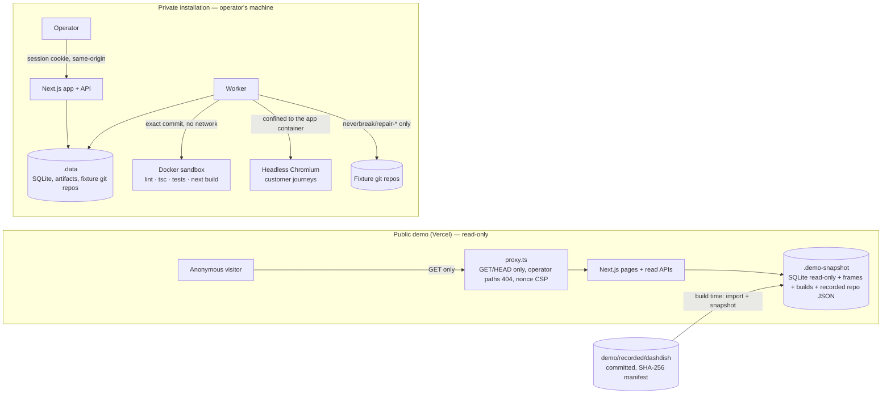

# What happens in the background

The product view stays simple. This is everything underneath it: how NeverBreak learns flows, checks a change, and repairs it, and the sandbox that runs the code.

## NeverBreak, step by step

1. **Learn.** From the last passing run, every test the runner reported as passing becomes a protected flow, plus the built page opening in Chromium and any customer journey that reached its expected screen. Stored with the commit it was learned from.
    
2. **Check.** Each new change runs the full pipeline below. A flow passes only if its own test passed in this run's recorded output and, where it has one, its Chromium journey reached the expected screen.
    
3. **Notice.** Failed or deleted tests are regressions. If the change rewrote the test protecting a flow, the flow is flagged even when it passes.
    
4. **Repair.** At most two attempts, each a real commit on a neverbreak/\* branch verified by a normal run, re-checking protected flows and the change's new checks. 1: a prepared targeted fix, or restore the touched code. 2: roll back. Then stop.
    

No repair is written by AI. A prepared targeted fix (DashDish) was written in advance and is labelled that way; the other strategies only put back code known to have passed, and are reported as roll-backs because they drop the new feature. Repairs never edit the project's own branches and never push anywhere. An AI repair step is planned but not built; no API key was available to test one.

## The sandbox

The web app never runs code. A separate worker executes each check in a locked-down container and writes every state change to the database, which is all the interface ever reads.

Browser

-   Session cookie only
-   Polls run state each second

Next.js app + API

-   Auth, same-origin checks
-   Allowlisted repo, SHA pinned
-   Queues runs; never executes

Database

-   Runs, checks, logs, hashes
-   Source excerpts, screenshots
-   One active run per commit

claims queued runs

Headless Chromium

-   Follows scripted journeys
-   Measures values in the DOM
-   Saves hashed PNG frames

Sandbox container

-   No network · read-only root
-   Non-root · caps dropped
-   CPU, memory, PID, time limits

Worker

-   Exports the exact commit
-   npm ci --ignore-scripts
-   Heartbeat, cancel, recovery

Commands come from a server-side allowlist. The snapshot server runs on an internal-only Docker network with no route out.

## Pipeline

1. **Prepare.** git export of the pinned SHA
    
2. **Dependencies.** npm ci, scripts disabled
    
3. **Lint · Types · Tests · Build.** each in its own sandbox
    
4. **Snapshot.** optional; never part of the verdict
    
5. **Evidence · Verdict.** hash logs, keep source lines, decide from exit codes
    

## Boundaries

Verdict

One function (lib/shared/verdict.ts) from exit codes. Environment errors, timeouts and dead workers become Incomplete, never Failed.

Evidence

Terminal codes stripped, secrets redacted, size capped, SHA-256 hashed. Screenshots served only to the run's owner.

AI

Optional. Reads sanitized output fenced as untrusted data, must return validated JSON, stored separately, cannot change a verdict.

Access

One operator behind an access code; HMAC-signed httpOnly session; every query scoped to the project owner.

Repositories

Local repos under the data directory, or one allowlisted GitHub repo with a read-only token. Refs validated before git. Repair commits are written only to the local demo repository, only on neverbreak/repair-\* branches, through a private git index.

Not built

Hosted deployment, Supabase (migration written, never run), multi-tenant isolation, gVisor-class runtime.

## Deployments: public demo and private installation

The public demo and the private installation are separate. Only the private installation executes code.

## Request and verification lifecycle

**Recorded mode** (public demo, or any installation without a worker):
1. The prompt is matched in the browser.
2. The recorded runs for that scenario are replayed from stored timestamps, labelled "Recorded demonstration".
3. The page makes no server writes.

**Live mode** (private, operator signed in, worker and Docker running):

1. `POST /api/projects/dashdish/requests` with `{ prompt, protection }`. The server checks the operator session, same-origin, the body schema, the same deterministic matcher, and the worker heartbeat. It then queues the prepared revision for that scenario.
2. The worker claims the run. It exports the exact commit, runs `npm ci` on the host under a fixed policy (registry-only lockfile, pinned npm config, no scripts, no git), and then runs each check in Docker with no network.
3. After a passing build, it serves the static export on an internal Docker network and runs the customer journeys in Chromium, confined to that container.
4. Every state change is written to SQLite. The page polls and shows only what was recorded.
5. **Protection ON:** if a protected flow failed, the page requests the controlled repair. The worker verifies each attempt as a normal run on `neverbreak/repair-*`.
6. **Protection OFF:** no repair, and the API refuses one (409).
