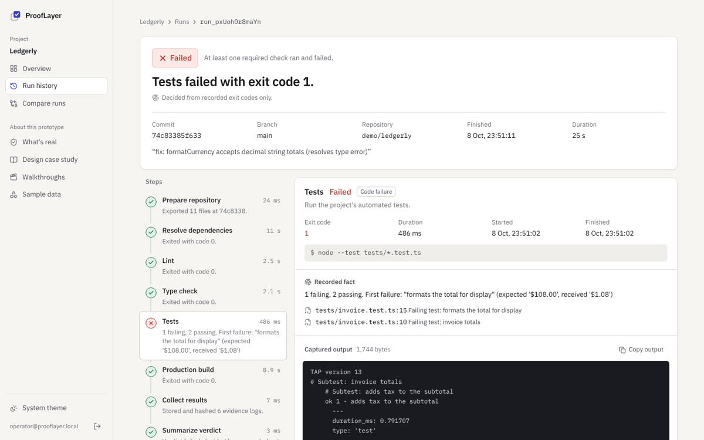
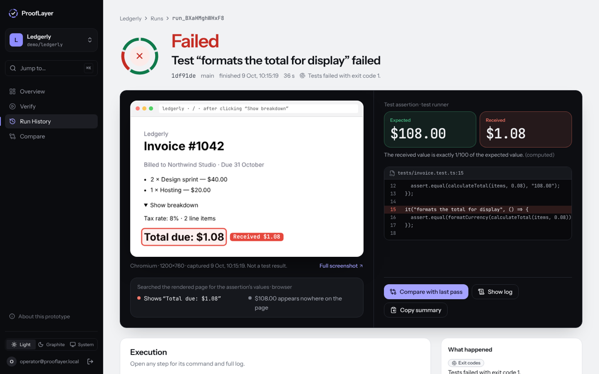

# Designing for proof, not reassurance

> Moved from the app into the repository: the public demo opens straight into the product, so the design and validation documentation lives here.

AI coding agents report success in the same confident voice whether or not the code works. ProofLayer is an attempt to give that claim a second, independent opinion, and to present the result so a founder and an engineer reach the same conclusion from the same screen.

**Assumption, not research.** No user interviews, usability tests or analytics informed this project. Everything below labeled as a user need is a hypothesis taken from the brief and from my own reasoning. Where something was actually tested, it was tested on the software, not with people.

## Problem definition

Tools that generate applications can produce working code quickly, but a person asking for a fix usually has one signal that it worked: the agent saying so. When that signal is wrong, the cost lands later, at deploy time or in front of a customer.

The question ProofLayer answers is narrow on purpose: _did this exact commit pass the checks this project can run?_ Not “is the app good” and not “is the bug fixed”, which no automated check can promise.

## Version six: the signature experience

Version five proved the idea on an invoice page, and it still looked like a testing dashboard. Version six puts the promise first, **“Your AI builds it. We make sure it keeps working.”**, and shows it on something people recognise: DashDish, a fictional food delivery app, running inside ProofLayer in a phone.

-   **One story, three real revisions.** The agent is asked to “Let customers schedule food delivery for tomorrow.” Revision A works. Revision B adds scheduling and quietly makes every order require a delivery window, so regular checkout fails with “Choose a delivery time”. Revision C changes one condition so only scheduled orders need a window. Each is a real commit, built and checked in the sandbox; nothing about the outcome is stored in the interface.
-   **Three columns with one job each.** The change on the left, compact. The app in the centre, always labelled as what it is: an interactive build of a specific commit, a recorded Chromium frame, or a designed waiting state that never pretends to be a screen. NeverBreak on the right: an evidence network (the change flowing through lint and types, tests, build and Chromium into the protected and new journeys) above plain sentences, each tied to a run, a check or a frame. Every node lights up only when its recorded check does.
-   **An app worth protecting.** DashDish has discovery, a restaurant menu, a dish screen with sizes and add-ons, a cart with coupons, immediate or scheduled delivery, and confirmation. The browser journeys order a large pizza with extra cheese, so the evidence shows the product, not a test harness.
-   **Watch NeverBreak in action.** Seven scenes replayed from the timestamps the worker recorded, at four times real speed, about 80 seconds end to end. It can be paused, skipped, jumped by scene and replayed; “Check it live” follows a new run as it happens. The closing line, “Changes verified. Existing journeys protected.”, only appears when the results support it.
-   **Repair versus rollback, kept apart.** A rollback makes the old journeys pass by deleting the new feature. That is a safe outcome, not a repair, and the interface says “Rolled back” when it happens. A repair counts only when the protected flows and the change's own new checks pass together.
-   **Honest about who wrote the fix.** No model was available, so revision C is a prepared reference fix on its own branch. NeverBreak applies it on an isolated branch and verifies it; every place it appears says it was written in advance and not generated.
-   **Protected flows as a journey.** Discover, Menu, Cart, Checkout, Confirmation, each with the frame Chromium recorded at that step and a status: passing now, broken now, new and not yet protected, or untested. Selecting a step opens its proof.
-   **One theme.** Graphite: near-black surfaces, violet and indigo for NeverBreak, coral reserved for DashDish and new work, and green, amber and red only for outcomes. Geist for type. Motion follows real state changes and turns off under reduced-motion settings.

**Assumption, not research.** The food app makes the story legible to non-engineers; that is a hypothesis. The engineering underneath was checked on real runs, at five widths, by keyboard and with reduced motion, not with users.

## Version five: NeverBreak

Four versions in, ProofLayer could prove whether a commit passed. It still asked the reader to think like a CI system. The product story became one feature: **NeverBreak protects what already works.** When an AI agent changes the app, the flows that worked before are checked again, a regression is shown with the real page, and a careful repair may be tried and verified.

-   **Flows instead of checks.** A founder doesn't care that “Tests exited 1”; they care that “Total due shows the right amount” broke. Flows are learned from what the test runner reported as passing in the last good run, plus the page opening in a browser, so they are never invented. The names on the demo app were written by hand, and the page says so.
-   **Two layers.** The product view answers six questions: what changed, what was protected, what broke, whether it was fixed, and the proof. Everything else (sandbox steps, logs, exit codes, the deterministic assistant) lives in “Behind the scenes”, closed until asked for.
-   **A repair that earns trust.** Two attempts, then stop. Each is a real commit on its own branch, verified like any change, and shown with its own proof. The first attempt keeps the agent's other edits; on the demo it fails because the agent had also rewritten a test. The second rolls back the whole change and passes. The interface says plainly that this means the change is undone.
-   **A guard against moved goalposts.** If the change rewrites the test that protects a flow, NeverBreak flags it even when the test passes. In the demo, the agent changed “adds tax” to expect the new behaviour; the flow is marked “Its test was edited”.
-   **Honest limits.** The repair was rule-based, not AI, because no model could be tested. It only writes to the demo repository, never to main, and never pushes. (Version six adds a prepared targeted fix, still not AI.)

**Assumption, not research.** The flow-first framing is a hypothesis about what non-engineers need. It was checked against real runs, not with users.

## Version four: an investigation workspace

Version three answered “did it pass?” well, but it still read as a report. A reviewer with ten seconds needs four answers in order: what the change claimed, whether it worked, what verification actually saw, and what to do next. Version four arranges one run around those questions.

-   **The claim is the headline.** The commit message, quoted, is the page title. The verdict and a plain sentence (“The total due is wrong.”) answer it on the right. That sentence is assembled from the text Chromium found around the wrong value, and it names its source; when there is no such text it falls back to the test name or the compiler, never to a guess.
-   **Three columns, one direction of reading.** Steps on the left, the app itself in the centre, findings and actions on the right. Logs, commit metadata and diagnostics moved into a collapsible inspector that opens on demand, already scrolled to the failing step. Below 1280 px the timeline becomes a compact row; on phones the order is findings, app, assistant, inspector.
-   **A live workspace instead of a black console.** While a run is in progress, the centre shows an empty browser frame that says plainly it hasn't opened yet, and below it the current step, its command, elapsed time, the last lines of output and the checks already finished. When the worker reaches the browser step, the frame reports what the browser log says, in the browser log's words.
-   **A proof reveal that only plays for real.** When the page sees a run finish, the verdict, the sentence, the two values, the screenshot and the highlight arrive in sequence over about two seconds, then the recovery action. Open or refresh a finished run and everything is simply there. Motion runs 180 to 350 ms per element and is removed under reduced-motion settings.
-   **The screenshot stays unaltered.** Highlights are a separate layer drawn from coordinates the browser measured, with a toggle to hide them and another to see the full capture instead of the focused crop.
-   **An assistant that doesn't pretend.** Five prompts (“What failed?”, “Which check caught this?”, “What changed since the last passing run?”…) are answered by fixed functions over the recorded evidence and git. Each answer carries a label, “From recorded evidence” or “Rule-based guidance”. There is no chat box, because there is no model behind it; the optional AI interpretation stays in the inspector, dashed and labelled, and is off without an API key.
-   **Before and after.** Compare now opens on the last pass against the latest failure: both real screenshots, the checks that changed outcome, and the actual diff. On the fixture, the diff shows the cause: the total is now converted from cents to dollars in `calculateTotal`, while `formatCurrency` still divides by 100.
-   **A warmer identity.** A lightly tinted canvas, deep violet-black ink, one soft violet accent, and Bricolage Grotesque for headlines. Dark is used where it helps reading: code, logs and diffs.

**Assumption, not research.** As before, these are design hypotheses checked against the software (real runs, five viewport widths, keyboard and reduced motion), not with users.

## Version three: product first

Version two had the right evidence but still read like documentation: the sidebar gave the case study, walkthroughs and sample data the same weight as the product, and a reviewer had to scroll past a long report to reach the one thing that mattered.

-   **Four destinations.** Overview, Verify, Run History, Compare. Everything for reviewers sits behind one small “About this prototype” link with its own tabs, including a new Architecture page.
-   **One click to real execution.** The overview leads with a factual headline (“The latest commit fails 1 of 5 checks”) and a dominant Run button. The Verify studio runs the commit in place, shows live recorded progress, then turns into the proof without a page change.
-   **A skippable guided demo.** Five steps that advance on real state, not timers. If a reviewer will not wait, it offers the last run, labelled as recorded evidence.
-   **The proof stage.** A dark panel in every theme, so evidence is always the highest-contrast thing on the page. The screenshot is framed to the page content, and the ring on “Total due: $1.08” comes from coordinates Chromium measured while searching the DOM for the assertion's values. If the value is not on the page, no ring is drawn.
-   **Light by default.** Not everything needs to be dark. Light work surfaces, a graphite rail, and the dark stage for evidence; graphite remains a theme.
-   **Less text.** Subtitles cut to a line; explanations moved into the About section.

**Assumption, not research.** Version three was reviewed through Playwright screenshots at 1440, 1280, 1024, 768 and 390 pixels and keyboard-only runs, not with users.

## Where version one fell short

The first version was functionally honest and visually generic: a white admin layout with a vertical list of steps on the left and the selected step's raw output on the right. Every fact was there. Finding it was the person's job.

**Version one.** A step list and the selected step’s raw output. The $1.08 is in a one-line summary and the log.

**Version three.** Verdict, then the proof stage: the real page with a measured ring on $1.08, expected against received, and the source line.

Walking the demo failure through it showed the problem. The headline said _“Tests failed with exit code 1.”_ The fact that actually matters, that an invoice total of $108.00 came out as $1.08, did appear, but only as the tail of a one-line summary under the step heading, at the same size and weight as the step durations around it, above a dark block of raw TAP output. A founder could easily miss it; an engineer would find it by reading, not by seeing.

The raw-dashboard pattern had three specific shortcomings:

-   **It answered “what ran” before “what happened”.** The step list was the primary structure, so the page described the pipeline rather than the outcome.
-   **Every step had equal weight.** Eight rows of the same size, five of them saying “Exited with code 0”, around the one that mattered.
-   **The next action sat below the fold.** Recovery options and the explanation panel came after the log, the furthest point from the verdict.

**Assumption, not research.** These shortcomings come from my own walkthroughs of the first version, not from observing users.

## The verification workspace

The run page became a workspace with three zones, each answering one of the product's three questions:

| Zone | Question | Contents |
| --- | --- | --- |
| Centre, top | What happened? | The proof seal and verdict, a human-readable failure title built from parsed facts, the commit and duration. |
| Centre, middle | Can I trust the result? | Evidence: expected against received values, the source lines from the commit, a captured browser snapshot when one exists. Then the execution timeline, with logs one click away. |
| Right | What should I do next? | Labelled facts, next steps, the last verified revision, the optional AI interpretation, and the commit. |

The navigation rail moved to graphite, with a project switcher listing only the projects the server allows and a ⌘K palette for keyboard-first movement between pages and recent runs. Below 1280 pixels the right zone drops beneath the centre; on phones everything stacks in reading order: verdict, evidence, timeline, diagnosis.

The **proof seal** is the one signature element. It has one arc per required check, coloured by that check's recorded status, around the verdict glyph. It doubles as a progress indicator during a live run, because arcs only change when the worker records a new status. It carries data, not decoration.

## Designing the failure experience

A failed run should read like a diagnosis, not a stack trace. In order, the page now shows:

1.  **A human-readable title.** “Test ‘formats the total for display’ failed”, or for the type error, “A string is passed where a number is required”. Both are assembled from the tool's own output, never written by a model.
2.  **Expected against received.** Large, side by side, in the values the assertion recorded. For type errors, the required type against the type that was passed in.
3.  **A computed relationship** when both values are numbers: “The received value is exactly 1/100 of the expected value.” This is plain arithmetic on the two recorded values, labelled as computed.
4.  **The source line** the runner reported, copied from that exact commit while its workspace existed.
5.  **The rendered page**, when the build passed and a browser is installed on the worker: a real Chromium screenshot taken after a known interaction. For the demo's third commit it shows “Total due: $1.08”. It is labelled as a capture, not a test result, and never affects the verdict.
6.  **The previous verified revision** and what changed since it, then next steps.

Nothing is inferred from a unit test about how the page looks. If no screenshot exists, the space is simply not shown, and the sample data says so explicitly.

## Why evidence comes before logs

Logs are complete but unranked: everything the tool printed, in the order it printed it. Evidence is the subset that decides the outcome, ranked by how directly it explains it. Showing evidence first means a founder can stop after one screen, and an engineer can verify the claim against the source line without scrolling.

Logs did not lose any standing. Every step in the timeline expands to its command, exit code, timestamps, parsed locations and full captured output, and the evidence section links straight to the relevant one. The default is simple; the depth is one click away.

## Keeping verification and AI apart

Every statement in the diagnosis panel carries its source:

Test runner (source)Compiler (source)Linter (source)Exit codes (source)Computed (source)Browser (source)Worker (source)AI inference (source)

Deterministic sources share one quiet, solid style. AI inference is the only dashed one, and it lives in its own dashed container headed “AI interpretation”. A recorded fact and a model's hypothesis never share a block. The verdict is computed by one function from exit codes and cannot be changed by anything the model writes.

When no API key is configured, the panel says so in words: no explanation has been generated, and nothing on the page came from a model.

## User frustrations and research

The brief lists problems reported across AI coding tools. I treated each as an unvalidated hypothesis and mapped it to a design response:

| Reported frustration (hypothesis) | Design response |
| --- | --- |
| The agent says a bug is fixed when it is not | An independent run with a verdict decided by exit codes, never by a model |
| Fixing one thing breaks another | Comparison that names checks that started failing and checks that recovered |
| Repeated debugging burns time and credits | Evidence and a copyable summary, so the next attempt starts from facts |
| Deploys fail after an apparently good build | A production build is a required check |
| Errors are hard to understand | Parsed facts first, optional plain-language explanation second |
| Not knowing which version last worked | The last passing commit, shown only when a recorded run supports it |

The next step would be five or six conversations with people who build with AI app builders, focused on the moment they decide whether to trust a fix. I have not done them.

## Target users

**Assumption, not research.** These are proto-personas: assumptions to design against, not findings.

The non-technical founder

Builds an internal tool or MVP by prompting. Cannot read a stack trace and should not have to. Needs a yes or no they can act on, and to know when the answer is “we could not tell”.

The developer reviewing agent output

Uses agents to move faster and checks their work before merging. Needs the exact command, exit code, output and commit, quickly, and needs to trust that nothing was summarized away.

The engineer supporting customers

Debugs other people's generated apps. The person a forward-deployed engineer is. Needs to tell an environment problem from a code problem, and to hand over a precise diagnostic.

## Primary journey

1.  1
    
    **An agent reports a fix.** The person opens the project and sees the latest verdict at the top, readable in seconds.
    
2.  2
    
    **They pick the commit.** Commits are listed with their own verification state; the head commit carries the primary action.
    
3.  3
    
    **They watch it run.** Steps light up only as the worker reaches them. Output streams from the sandbox.
    
4.  4
    
    **They read the verdict.** One sentence states what was recorded, e.g. “Tests failed with exit code 1.”
    
5.  5
    
    **They decide.** Evidence, comparison with the last passing run, an optional explanation, a rerun, or a copied summary for someone else.
    

The demo repository is built around this journey. Its third commit is titled “fix: … (resolves type error)”. It does resolve the type error. It also makes every invoice total a hundred times too small, and only the tests notice.

## Information architecture

Four levels, each answering one question:

| Level | Question it answers | Where |
| --- | --- | --- |
| Project | Is the latest code in a good state? | Overview |
| Commit | Has this exact version been verified? | Commit list on the overview |
| Run | What happened when it was verified? | Run page, history, comparison |
| Step and evidence | Why, exactly? | Evidence panel on the run page |

Navigation stays shallow: Overview, Run history and Compare per project, plus the pages that explain the prototype itself. Live progress, results, AI explanation and recovery are one page, because they are one moment in the person's day: a run does not change identity when it finishes.

## Design rationale

**The verdict is a sentence.** A badge says how it went; the sentence underneath says what was recorded. The sentence is generated from exit codes so it cannot drift from the evidence.

**Facts and interpretations look different.** Recorded facts sit in solid boxes marked with a fingerprint icon. AI text sits in a dashed accent border labeled as a hypothesis with its confidence and model. The two are never mixed in one block.

Verified failure

Tests failed with exit code 1.

AI interpretation · hypothesis

The total may be treated as cents after being converted to dollars.

**An evidence spine instead of a progress bar.** Every step is listed from the start, in order, with its duration and a one-line result. Progress is shown by state, not by an estimated percentage the system could not honestly compute.

**No scores.** There is no health score, reliability percentage or trend line. With a handful of runs they would be noise dressed up as insight. History is shown as one mark per real run.

**Recovery offers options, not automation.** Rolling back or pushing code on someone's behalf is exactly the kind of unverified agent action this product exists to question.

## Verification status model

Passed

Every required check ran and exited 0.

Says what passed, and that a pass is not proof of no bugs.

Failed

At least one required check ran and failed because of the code.

Names the check and exit code. Other checks still run so the evidence is complete.

Incomplete

No code failure, but a required check could not run or finish: environment error, time limit, memory limit, worker stopped.

States it is not evidence the code is broken. Recovery advises fixing the environment, then rerunning.

Cancelled

The person stopped the run.

Still reports any failure recorded before cancellation.

Incomplete is the most important of the four. Without it, an expired registry token or a full disk becomes a red “Failed” on someone's code, and the tool teaches people to ignore it. Each step also carries a failure class (code, environment, time limit, resource limit) so the spine can show why a step did not pass.

pending running passed failed could not finish not run cancelled

## Key interaction decisions

-   The run page follows the step that is running, until the person selects a step themselves. Then it stops moving under them.
-   Output scrolls to the newest line while streaming, with a visible “Follow output” control to turn that off.
-   Cancel is available only while a run is active, and changes to “Cancelling…” until the worker confirms.
-   Queuing the same commit twice opens the run already in progress instead of starting a duplicate.
-   Rerun copy differs by verdict: after Incomplete it suggests fixing the environment; after Failed it warns that a code failure will reproduce.
-   Comparison always uses the older run as the baseline when two are picked from history, so “started failing” means what it says.
-   “Copy a diagnostic summary” produces plain text for a ticket: verdict, commit, and each check's exit code and summary.

## Visual design system

Version two moved from warm paper to a graphite instrument panel: a near-black navigation rail that stays dark in every theme, rich neutral work surfaces, and one restrained blue-violet accent reserved for action and focus. Status colours appear only on outcomes, and never alone: every marker pairs colour with a glyph and a word. Graphite is the default; a light “paper” theme and a system option redefine the same tokens rather than inverting them.

Canvas

Surface

Ink

Accent

Passed

Failed

Incomplete

Cancelled

Type is Instrument Sans for the interface, chosen for its compact, slightly editorial shapes at display sizes, and JetBrains Mono for anything a person might copy or compare: SHAs, commands, file paths, output, and the expected and received values. The scale runs 12, 13, 14, 16, 19, 24, 32, 44 and 64 pixels; the verdict word is the only text set at the top of it. Radius has four steps so badges, controls, cards and dialogs read as different kinds of object.

Motion only reports real work or answers an action: arcs draw in as checks finish, a marker settles when its status is recorded, the running step pulses, expanded rows fade in. All of it is removed under reduced-motion settings.

## Accessibility

-   Landmarks, a skip link, one h1 per page, and captions on data tables.
-   Every interactive element is a native button, link, checkbox or select, reachable by keyboard with a visible focus ring.
-   Steps announce their status to screen readers; the verdict heading is a polite live region so a finished run is announced.
-   The streaming log is not a live region, to avoid flooding screen readers; it is focusable and scrollable by keyboard.
-   Text and status colours were chosen for contrast on both themes; status always pairs colour with an icon and a word.
-   prefers-reduced-motion removes all animation.
-   Version two adds a ⌘K / Ctrl+K command palette (combobox with arrow-key navigation), arrow-key tabs between failing checks, and accordion steps that expose their state with aria-expanded.
-   The proof seal is an image with a text alternative listing every required check and its status.

Checked with keyboard-only browser automation and by inspection. Not audited with assistive-technology users.

## Technical feasibility

The design only promises what the system can back. A step shows as running because the worker wrote a start time to the database. A verdict exists because a single function computed it from exit codes. A “last verified commit” appears only if a Passed run is on record.

Execution happens in a separate worker, never in the web server, because a serverless function cannot safely host a container runtime. Each check runs in a container with no network, a read-only filesystem, an unprivileged user and hard limits. Commands come from a server allowlist; the repository cannot choose what runs. See [What's real](/about/real) for exactly what was tested.

## Limitations

-   No user research. Every user need here is an assumption.
-   Node projects only, with a narrow set of supported test runners and build tools.
-   A single operator account and a single worker; not deployed.
-   The AI explanation path has been tested only for its failure states.
-   The browser snapshot needs Chromium on the worker host and covers one page and one interaction per project, defined on the server.
-   Failure titles and expected/received values exist for node:test, Jest/Vitest-style assertions and TypeScript errors only; other output falls back to the last lines of the log.
-   The redesign has not been tested with people. The workspace layout and the evidence-first order are hypotheses.
-   Passing checks are evidence about those checks, not about the whole application.

## Future improvements

-   Validate the journey with five or six people who build with AI tools, starting with whether “Incomplete” is understood.
-   Run verification on GitHub Actions in the customer's own repository, reporting back to a hosted ProofLayer.
-   Let projects declare which checks are required, with a reviewed configuration file.
-   Behavioural checks against a running preview (smoke tests of key pages), which is closer to “is the bug fixed”.
-   Post the verdict back to the pull request or to the agent that made the change.
